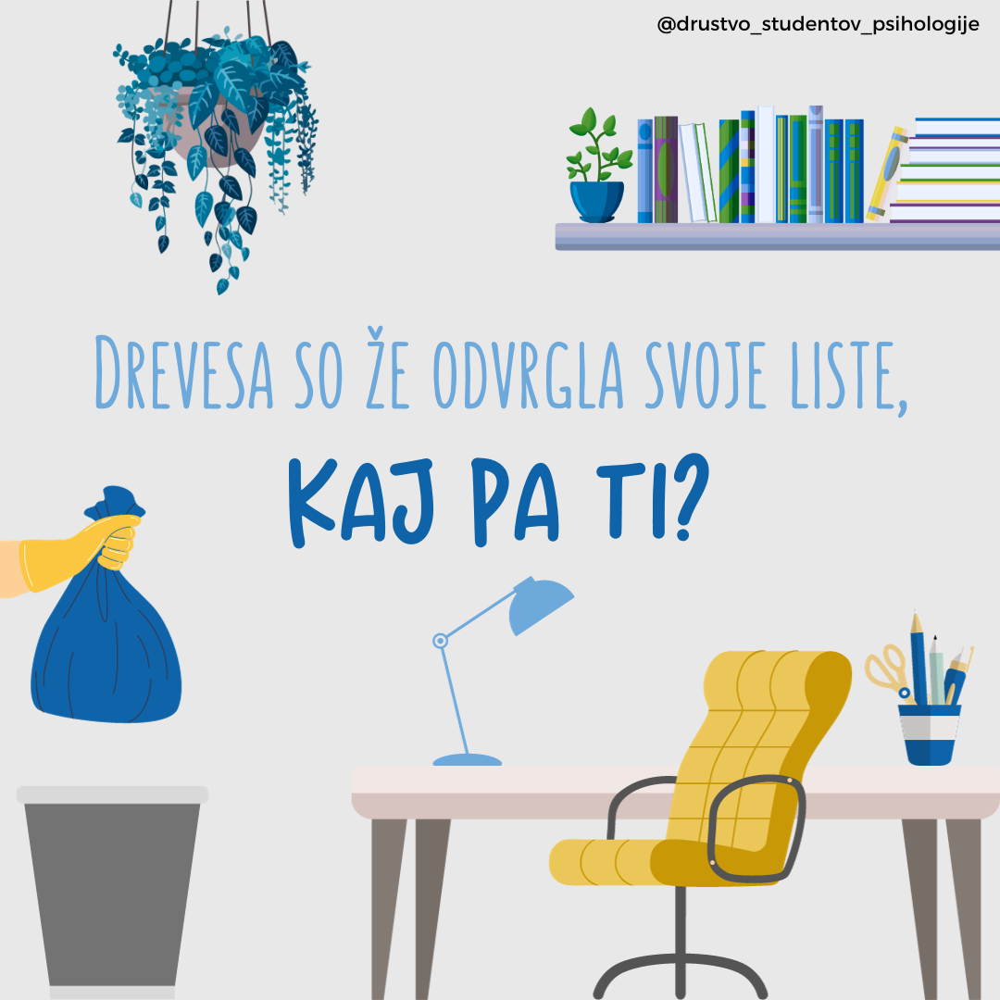
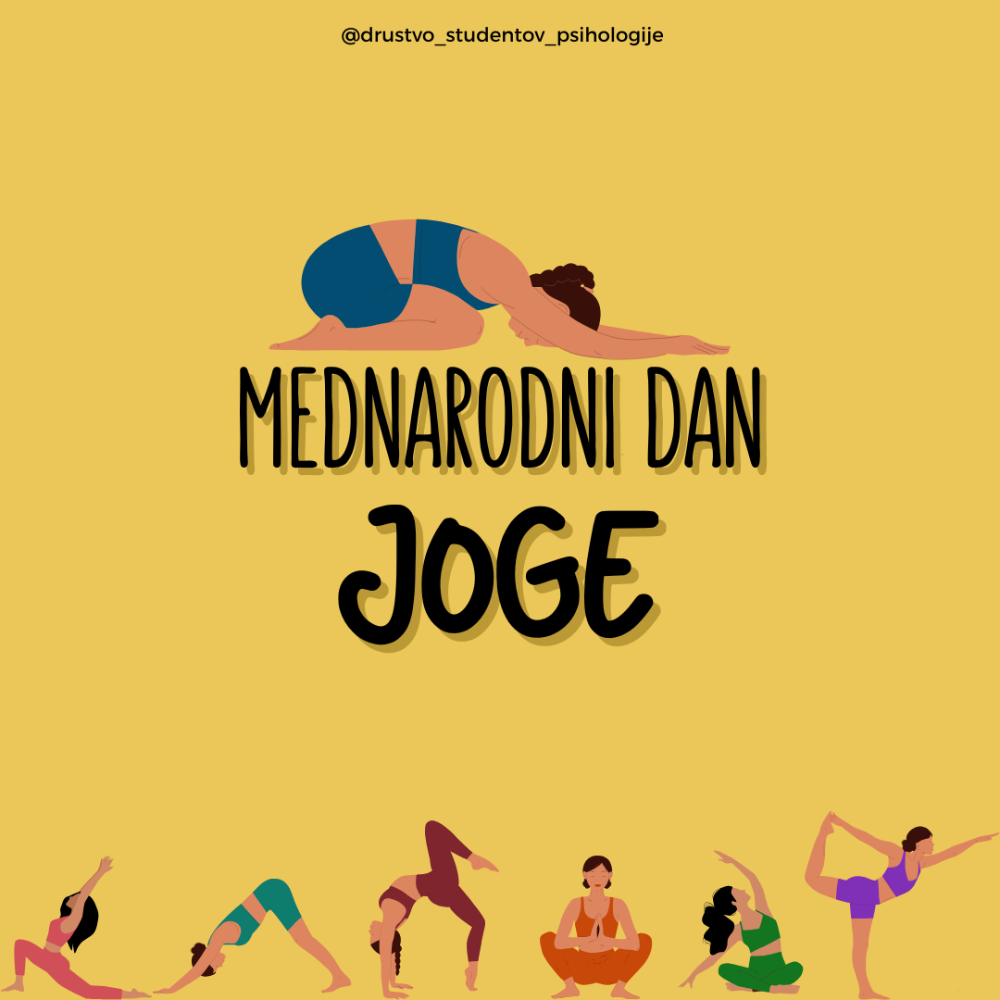
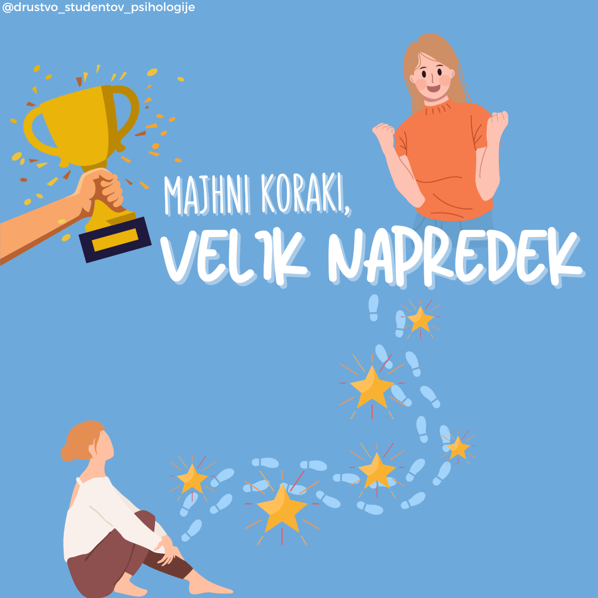

## Master's thesis

*Investigating the gap between true scores and observed scores in the measurement of psychological processes: A formal theory of scaling*

Currently, I am working on my master's thesis, which is a blend of methodology and psychology. The aim of this project is to formulate a theory of the scaling mechanism and formalize it (basically, write it out in a programming language). A lot of psychological research is conducted using questionnaires for data collection. Participants filling them out must interpret the items, recall relevant information, aggregate it into a final judgement and transfer it onto the available response format. I am interested in the last part which I refer to as the scaling mechanism - the mapping of the internal judgement onto the scale.

## DŠPS work

As part of the PR group at Slovenian Psychology Students’ Association (DŠPS), I had the creative freedom to choose topics in psychology, research them and present them in an accessible way, along with interesting visuals I designed in Canva.

Below are some of my favorite Instagram and Facebook posts!

::: post-gallery
[{width="300px"}](https://www.instagram.com/p/C0JQQYMsmR_/?utm_source=ig_web_copy_link&mdxt=MzRlODBiNWFlZA==&srtk=MzRlODBiNWFlZA==)

:::

## Undergraduate publications

- [Ali se izvajanje in doživljanje medvrstniškega nasilja povezujeta z medosebnim nezaupanjem na prehodu v odraslost?](http://revijapanika.si/2025/02/14/ali-se-izvajanje-in-dozivljanje-medvrstniskega-nasilja-povezujeta-z-medosebnim-nezaupanjem-na-prehodu-v-odraslost/)
- [Psychological factors of flow state in online learning.](https://journal.doba.si/jimb/sl/article/view/JIBM.2024.16.2.3)